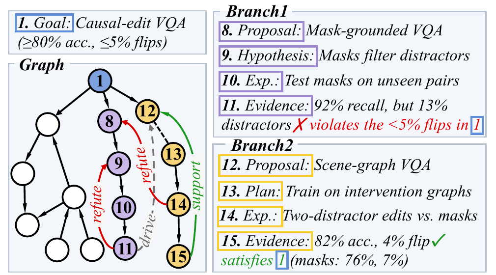
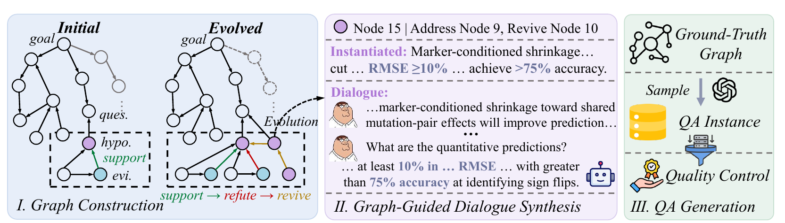

<div align="center">

# Twists and Turns: A Graph-Based Benchmark and Framework for Long-Term Memory in Exploration Tasks

Chongyuan Dai<sup>1</sup>, Yaling Shen<sup>2</sup>, Zirui Song<sup>1</sup>, Junfeng Liao<sup>1</sup>, Jinpeng Hu<sup>3</sup>, Xiuying Chen<sup>1*</sup>

<sup>1</sup>MBZUAI &nbsp; <sup>2</sup>Monash University &nbsp; <sup>3</sup>Hefei University of Technology

[](https://arxiv.org/abs/2611.06414)


</div>

## 📖 Overview

Long-term problem solving, such as scientific research and software development, moves along an evolving trial-and-error trajectory toward a central goal. We call these **exploration tasks**. To handle them, a model must remember facts, and also how solutions were tested against intermediate outcomes and how earlier attempts were revised or revived.

This repository contains:

- **LExMem**, a graph-guided benchmark for **Mem**ory in **L**ong-term **Ex**ploration tasks. It contains 224 dialogues and 2,018 question–answer instances derived from exploration graphs.
- **LExGraph**, a graph-based memory framework. It incrementally organizes a dialogue into interconnected memory nodes and retrieves evidence through hybrid retrieval and neighbor expansion.

<p align="center">
  
  <br>
  <em>An exploration task modeled as a graph. Two branches are highlighted; their steps are connected by relations.</em>
</p>

## 🧩 LExMem

<p align="center">
  
</p>

LExMem is built in three stages:

1. **Graph construction.** LLMs generate exploration graphs of typed nodes and relations. An evolutionary mechanism then adds realistic twists, such as contradictory evidence, refuted ideas being reconsidered, and revised hypotheses.
2. **Graph-guided dialogue synthesis.** Each graph is instantiated with a research or software-design task. Every node is then expanded into a block of multi-turn dialogue.
3. **QA generation.** Questions are generated from sampled structures (dense subgraphs, sparse paths and same-type node sets), followed by quality control.

| | |
|---|---|
| Dialogues | 224 (147 research exploration, 77 software design) |
| Dialogue length | 51K–174K tokens (88K on average), 4–16 sessions |
| Questions | 2,018 (561 dense, 759 sparse, 698 same-type) |
| Evolved graphs / seed tasks | 150 / 150 |

## 🕸️ LExGraph

LExGraph builds its memory graph from the raw dialogue only, without access to the ground-truth graphs.

- **Segmentation.** After every *n* new user turns, an LLM detects topic boundaries. Each segment becomes a memory node, with a key (summary and salient facts) and a value (the original turns).
- **Edges.** A new node attaches to a parent on the *right frontier*, i.e. the path from the root to the latest node. It is also linked to similar nodes on other branches through cross-branch edges.
- **Retrieval.** Nodes are ranked by cosine similarity and BM25, fused with reciprocal rank fusion. The top nodes and their graph neighbors are selected under token budgets and given to the LLM to answer.

## 📊 Main Results

Overall results on LExMem. ACC is LLM-judged accuracy (%). Per-type results and efficiency are in the paper.

| Method | Qwen-3.8 27B F1 | Qwen-3.8 27B ACC | GPT-6 Luna F1 | GPT-6 Luna ACC |
|---|:-:|:-:|:-:|:-:|
| Vanilla (full dialogue) | 0.579 | 58.36 | 0.500 | 59.03 |
| HippoRAG | 0.592 | 58.56 | 0.501 | 60.43 |
| ComoRAG | 0.616 | 61.18 | 0.501 | 60.08 |
| HippoRAG2 | 0.595 | 60.83 | 0.521 | 62.97 |
| StructMem | 0.634 | 59.97 | 0.519 | 61.81 |
| GraphRAG | 0.620 | 61.93 | 0.516 | 62.72 |
| Mem0 | 0.614 | 61.45 | 0.528 | 63.10 |
| LightMem | 0.619 | 61.50 | 0.522 | 63.59 |
| LightRAG | 0.624 | 61.67 | 0.527 | 63.46 |
| **LExGraph** | **0.667** | **63.92** | **0.566** | **64.00** |

## 📁 Repository Structure

```
.
├── benchmark/
│   ├── data/            LExMem: dialogues, graphs, seed tasks, questions
│   ├── evaluation/      token F1 and LLM-judged ACC
│   └── generation/      7-step data-generation pipeline and prompts
├── method/              LExGraph
└── assets/              figures
```

More details:
- [`benchmark/README.md`](benchmark/README.md): data format and evaluation.
- [`benchmark/generation/README.md`](benchmark/generation/README.md): regenerating the data.
- [`method/README.md`](method/README.md): LExGraph options and outputs.

## 🚀 Quick Start

### 1. Installation

```bash
git clone https://github.com/mbzuai-nlp/LExMem.git
cd LExMem
conda create -n lexmem python=3.10 -y && conda activate lexmem
pip install -r method/requirements.txt
```

LExGraph uses [gte-Qwen2-1.5B-instruct](https://huggingface.co/Alibaba-NLP/gte-Qwen2-1.5B-instruct) as its embedding model. Download it locally first.

### 2. Prepare the dialogues

To save space, each dialogue is stored once, annotated with the graph node of every message. The following command writes the plain dialogue `benchmark/data/dialogues/<id>/dialogue.json`, which is the only input an evaluated system may read:

```bash
python benchmark/data/make_dialogues.py
```

### 3. Run and evaluate LExGraph

`evaluate.sh` builds the memory graphs, answers all questions, and reports token F1 and ACC. The judge is gpt-4o-mini. There are two settings for what the answering LLM sees:

- `retrieval`: the retrieved memory only.
- `full_dialogue`: the full dialogue plus the retrieved memory.

```bash
cd method
export LLM_BASE_URL=http://localhost:8000/v1 LLM_MODEL=<model> LLM_API_KEY=...   # any OpenAI-compatible endpoint
export EMBEDDING_MODEL=/path/to/gte-Qwen2-1.5B-instruct JUDGE_API_KEY=...

./evaluate.sh retrieval     runs/lexgraph
./evaluate.sh full_dialogue runs/lexgraph     # reuses the graphs built above
```

> [!TIP]
> Running `full_dialogue` on the whole benchmark can be costly and slow, because every answer call reads an entire dialogue. You can sample a fixed random subset of dialogues (40 by default) and run on it instead:
> ```bash
> python ../benchmark/data/sample_subset.py --output subset_qa.json
> QA_FILE=subset_qa.json ./evaluate.sh full_dialogue runs/lexgraph
> ```

### 4. Evaluate your own system

Your system may read only `dialogue.json` and the `question_id`, `dialogue_id` and `question` fields of `benchmark/data/qa.json`. Write predictions as:

```json
[{"question_id": "...", "prediction": {"answer_items": ["...", "..."]}}]
```

Then score them:

```bash
python benchmark/evaluation/scoring.py --predictions results.json                          # token F1
JUDGE_API_KEY=... python benchmark/evaluation/llm_judge.py --predictions results.json --output judge \
    --base-url https://api.openai.com/v1 --model-name gpt-4o-mini --json-mode               # ACC
```

### 5. (Optional) Regenerate the benchmark

The full construction pipeline, from initial graphs to QA generation, is in [`benchmark/generation/`](benchmark/generation/README.md).

## 📝 Notes

- API keys are read only from environment variables.
- All LLM calls are cached on disk, so interrupted runs resume where they stopped.

## 📚 Citation

If you find this work useful, please cite:

```bibtex
@misc{dai2026twists,
  title         = {Twists and Turns: A Graph-Based Benchmark and Framework for Long-Term Memory in Exploration Tasks},
  author        = {Dai, Chongyuan and Shen, Yaling and Song, Zirui and Liao, Junfeng and Hu, Jinpeng and Chen, Xiuying},
  year          = {2026},
  eprint        = {2611.06414},
  archivePrefix = {arXiv},
  primaryClass  = {cs.CL},
  url           = {https://arxiv.org/abs/2611.06414}
}
```
